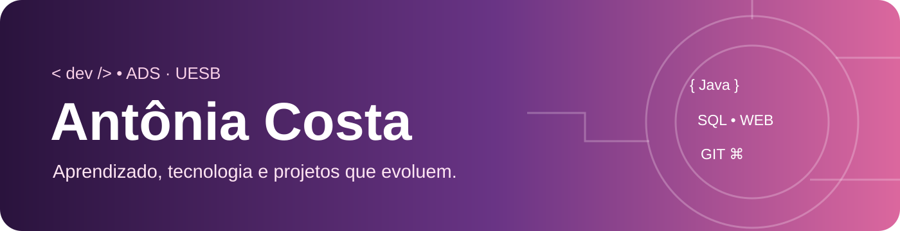

# 🌸 Olá, sou Antônia Costa!

**🎓 Estudante de Análise e Desenvolvimento de Sistemas — UESB**

*Tecnologia, criatividade e aprendizado a cada projeto.*

 

## 👩‍💻 Sobre mim
Sou **Antônia Costa**, estudante de **Análise e Desenvolvimento de Sistemas na Universidade Estadual do Sudoeste da Bahia (UESB)**. Aqui compartilho projetos acadêmicos e registro minha evolução na programação e no desenvolvimento de software.

## 🛠️ Tecnologias e conhecimentos em desenvolvimento

     

Java, SQL e orientação a objetos são apresentados como temas de estudo, sem pressupor domínio profissional.

## 💜 Projetos
- [🐾 Hotel Pet](https://github.com/antoniacosta25/Hotel-pet) — projeto acadêmico web.
- [☕ Café Expresso](https://github.com/antoniacosta25/Caf--Expresso) — trabalho de disciplina.
- [🤖 IFBot](https://github.com/antoniacosta25/IFBot) — repositório acadêmico.
- [📝 Formulário de Dados Pessoais](https://github.com/antoniacosta25/FormularioDadosPessoais) — prática com formulário HTML.
- [🌳 Manipulação da Árvore DOM](https://github.com/antoniacosta25/Manipula-o-arvore-dom) — exercícios de DOM.

## 📚 Áreas de estudo
Algoritmos · Orientação a objetos · Banco de dados · Engenharia de software · Estruturas de dados · Programação web · Modelagem de sistemas · Redes · UX · Desenvolvimento mobile.

## 🔗 Portfólio web
**[antoniacosta25.github.io](https://antoniacosta25.github.io/)** (disponível após publicar no GitHub Pages).

> Cada projeto é um passo na minha evolução como desenvolvedora.
